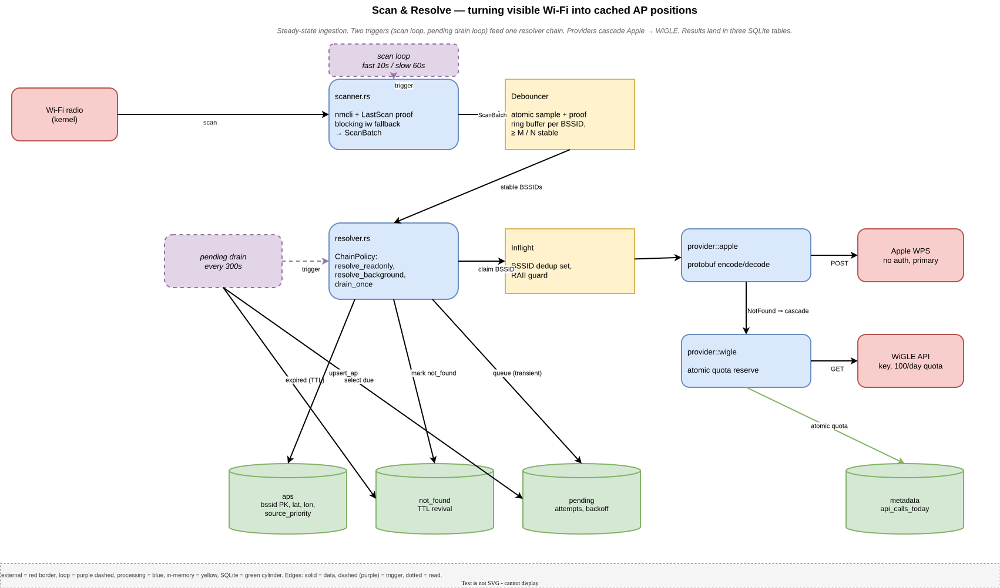
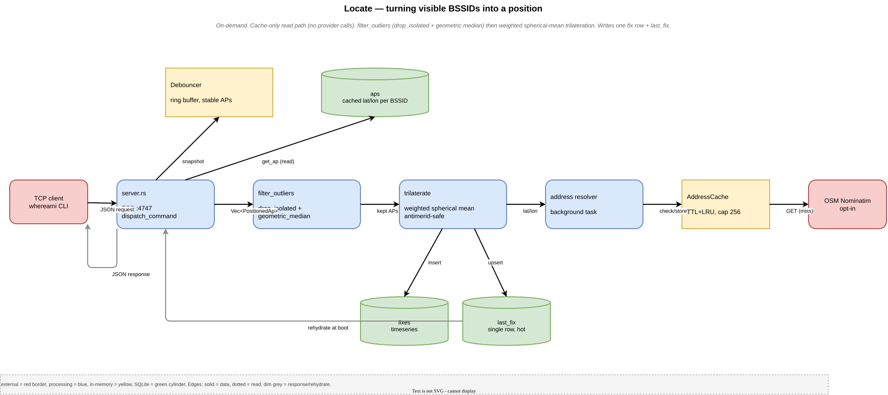
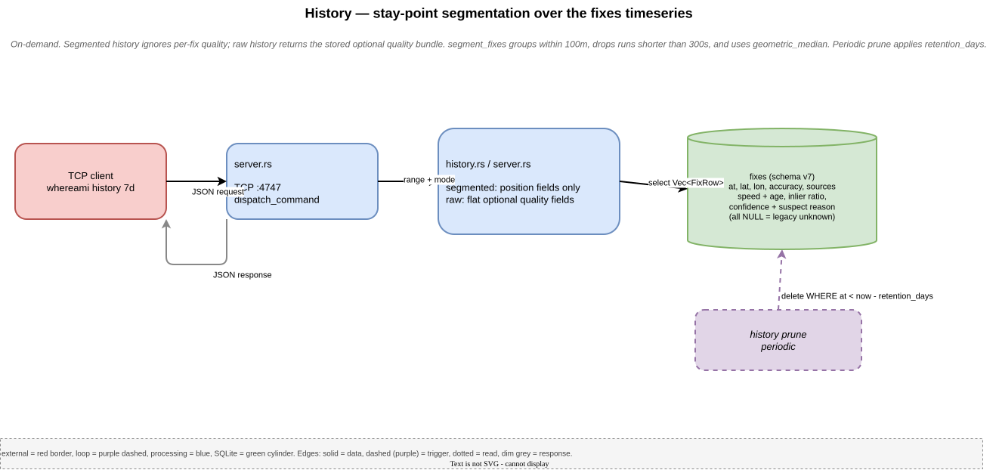
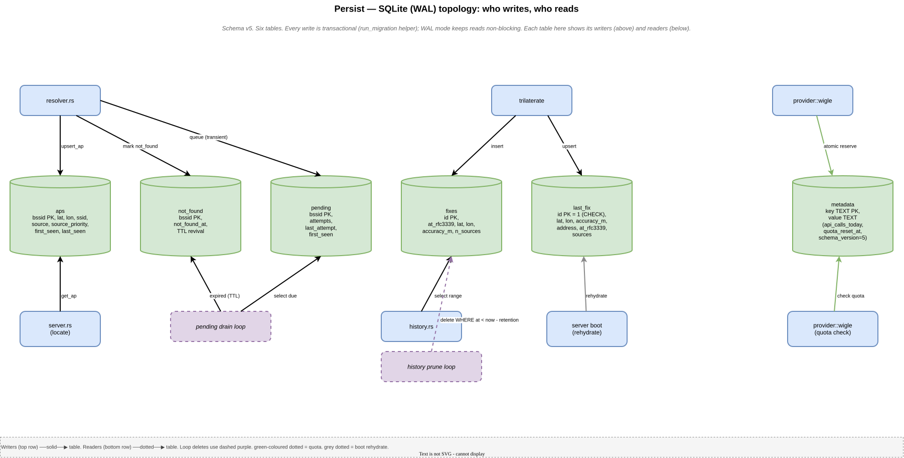

# whereami

Wi-Fi geolocation daemon for Linux. Scans nearby access points, resolves their
positions via Apple WPS (free, no auth) with WiGLE as a secondary backend,
caches results in SQLite, and answers "where am I?" over an access-controlled
Unix socket.

```
$ whereami locate
Magstræde 5, 1204 København K, Denmark
55.707250, 12.585598  ±12m  (6 sources, High)
```

## Why

Browser-based geolocation (Google, Mozilla) sends your Wi-Fi environment to
third-party servers on every query. GeoClue's Mozilla backend is dead.
whereami runs locally: it answers offline once your area is cached, talks to
Apple WPS on demand without an API key, and the cache lives on your disk.

## Quick start

```bash
nix-shell                                      # or: nix develop (same dev shell)
just build                                     # cargo build via Justfile
export WHEREAMI_SOCKET="${XDG_RUNTIME_DIR:-/tmp}/whereamid-$UID.sock"
cargo run --bin whereamid -- \
  --interface "$(ip -o link | awk -F': ' '/state UP/ && /wl/ {print $2; exit}')" \
  --socket "$WHEREAMI_SOCKET" \
  --db "$HOME/.local/share/whereami/aps.sqlite"
# in another terminal:
WHEREAMI_SOCKET="${XDG_RUNTIME_DIR:-/tmp}/whereamid-$UID.sock" \
  cargo run --bin whereami -- locate
```

That's it. **Apple WPS works without any credentials.** WiGLE is optional and
adds coverage; `wigle.net` gives a free key. The explicit database and socket
paths keep this manual, unprivileged run out of the compiled system defaults
under `/var/lib` and `/run/whereami`.

## CLI usage

The `whereami` binary speaks the daemon's socket protocol so you don't have to.

```bash
whereami locate              # where am I?
whereami scan                # currently visible Wi-Fi networks
whereami stats               # cache size, API quota, in-flight count
whereami debug               # per-BSSID debounce + DB classification
whereami history 24h         # stay-point segments over the last 24 hours
whereami history 24h --raw   # every fix (newest 1000 by default), no segmentation
whereami history 7d --raw --max-fixes 5000
whereami history 7d          # last 7 days; supports s/m/h/d/w
whereami history --from 2026-05-01T00:00:00+00:00 --to 2026-05-08T00:00:00+00:00
WHEREAMI_SOCKET=/path/to/whereamid.sock whereami wipe --yes # destructive; pin the daemon
whereami version             # CLI + daemon versions
whereami --json locate       # raw JSON output (any subcommand)
whereami help
```

## Configuration

The daemon's secret-store is a TOML file (default `~/.config/whereami/config.toml`):

```toml
[wigle]
api_user = "AID..."   # optional; daemon runs without WiGLE creds
api_key  = "..."
```

Manual and Home Manager deployments have the daemon read this ordinary file
directly. Keep it owner-only because another local user who can read or modify
it can steal or replace the WiGLE API credentials:

```bash
chmod 600 ~/.config/whereami/config.toml
```

For an ordinary file that it reads directly, the daemon warns when any group or
world permission bit is set. It does not print credential values, change the
mode, or reject the file; fix the permissions explicitly. Read-only owner
access (`0400`) is also safe. The NixOS system service uses a separate,
systemd-managed credential flow described below.

Everything else is a CLI flag (see `cargo run --bin whereamid -- --help`):

```
--socket <PATH>                     Unix control socket [$XDG_RUNTIME_DIR/whereamid.sock]
--bind <ADDR>                       TCP bind address (opt-in, unauthenticated; off by default)
--allow-nonlocal-bind               Permit a non-loopback --bind (exposes the daemon)
--db <PATH>                         SQLite database [/var/lib/whereami/aps.sqlite]
--interface <NAME>                  Wi-Fi interface [wlan0]
--config <PATH>                     Config file [~/.config/whereami/config.toml]
--max-connections <N>               Shared active connection cap, 1..=4096 [32]
--scan-interval-fast <S>            Fast-phase scan interval [10]
--scan-fast-duration <S>            Fast phase duration [60]
--scan-interval-slow <S>            Steady-state scan interval [60]
--autolocate-interval-secs <S>      Autonomous interval, 0..31536000; 0 disables [120]
--autolocate-max-scan-age-secs <S>  Confirmed scan age, 0..31536000; 0 legacy [180]
--debounce-window <N>               Ring buffer size [10]
--debounce-threshold <N>            Min appearances to be stable [5]
--top-n <N>                         Strongest APs for trilateration [10]
--max-travel-speed-kmh <KM/H>       Plausibility speed ceiling [250]
--mobile-ssid-denylist <GLOBS>      Comma-separated mobile-SSID globs [built-in list]
--pending-interval <S>              Pending queue drain interval [300]
--pending-max-attempts <N>          Give up after N failures [20]
--daily-limit <N>                   Max WiGLE API calls/day [100]
--not-found-ttl-days <N>            Re-check not-found after N days [30]
--address-approx                    Include street address (OSM Nominatim)
--address-cache-ttl-days <N>        Reverse-geocode cache TTL [7]
--http-timeout-secs <N>             Apple/WiGLE total timeout [15]
--nominatim-timeout-secs <N>        Nominatim total timeout [30]
--history-retention-days <N>        Prune fixes older than N days [30]
--aps-retention-days <N>            Prune APs not seen for N days [30]
--history-segment-distance-m <M>    Stay-point clustering threshold [100]
--history-segment-min-duration-secs Min stay-point duration [300]
```

## How it works

```
                 unix socket (0600/0660)
  any client  ------>  whereamid  ----> local SQLite cache
  (whereami CLI,         |                    |
   curl, Python…)        |              cache miss?
                         |                    |
                         +---------> Apple WPS  (no auth, primary)
                                     WiGLE API  (secondary, optional)
                                     Nominatim  (reverse geocode, optional)
```

1. Background scanner picks up nearby Wi-Fi APs via `nmcli` (preferred) or `iw`.
2. Debounce filter ensures only stable APs (seen repeatedly) drive the cache.
3. Positions resolve via Apple WPS first, then WiGLE; results cache locally.
4. Outlier rejection drops APs with stale/wrong positions.
5. Spherical-mean trilateration computes your location (antimeridian-safe).
6. The result is checked against the previous fix's implied travel speed. A
   result above the configured ceiling is marked Suspect and visible cached-AP
   consensus chooses between current trilateration and the previous fix.
7. Optional reverse geocoding via OSM Nominatim adds a street address.
8. Every accepted current fix is recorded in a `fixes` timeseries. `history`
   normally groups them into stay-point segments (100 m distance, 300 s minimum
   duration); `history --raw` bypasses segmentation and exposes the observations.

Human `locate` output appends the confidence. On a terminal, High is dim green,
Low is yellow, and Suspect is bold red; Medium and all redirected/piped output
remain uncolored. The speed check is deliberately necessary-but-not-sufficient:
a train or hotspot that evades the SSID denylist and moves at a plausible speed
can still form a coherent, high-confidence but wrong AP cluster.

## Accuracy

Urban areas with good Apple/WiGLE coverage: ~10-30m with 5+ resolved APs.
Suburban: 50-100m. Rural areas with sparse coverage may not resolve at all.

## Caching and offline operation

Apple WPS is free; the daemon will hit it on every cache miss. WiGLE has a
daily quota the daemon respects atomically (no quota overshoot under
concurrent locates). Once your area is cached, all queries are answered
locally with zero network traffic.

When offline, unknown APs are queued in a `pending` table. A background
drain re-tries them when connectivity returns, so the cache fills in
opportunistically.

After a daemon restart, the most recent fix is rehydrated from disk — `whereami
locate` answers immediately while the next scan-and-resolve cycle runs.

By default, the daemon also records a cache-only autonomous fix every 120
seconds. It reuses the scanner's latest stable Debouncer snapshot and already
cached AP positions; it never scans, calls Apple/WiGLE, queues pending work, or
schedules reverse geocoding on its own. This makes `history --raw` useful even
when no client repeatedly calls `locate`, at the cost of more SQLite writes.
Set `--autolocate-interval-secs=0` (or the shared NixOS/Home Manager option
`autolocateIntervalSecs = 0`) to turn it off. Enabled intervals are capped at
31,536,000 seconds (365 days).

Autonomous history additionally requires a recent, **confirmed forced-scan
lifecycle**. The default maximum age is 180 seconds, measured with Linux
`CLOCK_BOOTTIME` so laptop suspend time counts. Exact equality is accepted; even
one nanosecond older is skipped. For NetworkManager, the daemon records its
unique D-Bus owner, device object path, and `Device.Wireless.LastScan`
generation; captures `CLOCK_BOOTTIME`; then runs `nmcli device wifi list ...
--rescan yes`. Device and property reads are addressed to that unique owner. It
confirms only a strictly advanced `LastScan` at or after that attempt, re-lists
with `--rescan no`, and verifies that the owner/path remained the same and the
generation did not regress, including a trailing owner check after the final
property read. This matters because nmcli can exit zero with cached rows when a
forced request fails internally. A first-ever
`LastScan = -1` cycle is conservatively unconfirmed because NetworkManager may
update it at scan start as well as completion.

The fallback uses blocking `iw dev <iface> scan`, which returns its own results.
A proved nmcli post-generation list or successful iw direct output, including
empty output, is a valid fresh batch. Failed verification or refresh may retain
a non-empty cached nmcli `--rescan no` list for interactive `locate`, `scan`, and
`debug`, but it is explicitly unconfirmed. An unavailable or empty unconfirmed
nmcli cache proceeds to `iw`. Generic or exhausted-busy `iw` failures may
similarly use a separate cached `scan dump` as unconfirmed; an aborted direct
scan is not mistaken for a confirmed empty result. `iw` spawn failures,
timeouts, and a down interface are total errors and publish nothing. Any other
total scanner error also leaves the previous snapshot aging, and a privacy wipe
clears both the retained sample and its refresh evidence.

The 180-second default is three times the default 60-second steady scan cadence
and intentionally independent of the 120-second autonomous cadence. If scan
cadence is customized, budget the scan interval plus command runtime and
scheduling jitter; changing how often autolocate runs never makes an old scan
fresh. `--autolocate-max-scan-age-secs=0` (Nix:
`autolocateMaxScanAgeSecs = 0`) is an explicit legacy compatibility override:
it accepts any *present* snapshot, even unconfirmed or arbitrarily old. It does
not make a missing snapshot usable and does not disable the loop; use
`autolocateIntervalSecs = 0` for that. Positive values are capped at 31,536,000.

## Privacy, retention, and wiping

By default, the daemon removes location-history fixes older than 30 days and
resolved AP rows that have not been observed for 30 days. It runs one sweep at
startup and then daily, alternating bounded 1,000-row transactions between the
two tables. Configure the windows with `--history-retention-days` and
`--aps-retention-days`, or the Nix options `historyRetentionDays` and
`apsRetentionDays`. A value of `0` keeps that table indefinitely.

To delete the daemon's current logical location data immediately, use the
[socket-pinned wipe procedure](#verified-socket-pinned-wipe) for its deployment.
Do not use an unpinned command on a machine that may run both a system and a
personal daemon.

The command uses the filesystem-permission-gated Unix control socket and is
always refused over unauthenticated TCP, including loopback TCP. It atomically
deletes resolved APs, pending APs, negative-cache entries, fix history, the
persisted last-known fix, and the fix-ID sequence. It also clears the daemon's
managed in-memory scan/debounce, last-fix, address-cache, geocode-queue, and
in-flight lookup state. The success response reports exact per-table counts.
Schema state and operational metadata such as API quota and shutdown counters
are intentionally retained. Daemon configuration and WiGLE credentials live
outside these tables and are untouched.

Socket access is the authorization boundary. Every user authorized by the
socket's filesystem permissions (including every NixOS `allowedUsers` member)
can run the destructive wipe; there is no read-only or per-command role. The
`--yes` confirmation prevents accidental invocation but grants no additional
authority.

A wipe does not disable collection. Its exclusive boundary ends when the
server's response-write attempt terminates, whether by success, write failure,
timeout, or disconnect; later scans and queries may then repopulate the
database, and the autonomous locate loop may record new fixes without any
client query. If no complete response arrives, completion is unknown: verify
the state or retry the idempotent wipe. Stop or disable the daemon as well if
collection must remain off. This is logical live-state deletion, not forensic
erasure: SQLite free pages or WAL remnants, allocator/process-memory remnants
outside the managed structures above, filesystem snapshots, backups, storage
media, logs, and provider traffic already sent are outside its scope. Use
encrypted storage and separately manage snapshots/backups when those threats
matter.

An internal invariant panic after the database commit is fail-stop: the daemon
keeps the publication boundary held and exits nonzero before it can resume
serving partially cleared state. A systemd service can restart against the
already-wiped database; clients should treat the interrupted response as
unknown and verify or retry.

## Development

```bash
nix-shell            # or: nix develop; both select the flake's default dev shell
just build           # cargo build
just test            # cargo test --workspace
just lint            # cargo clippy --all-targets -- -D warnings
just fmt             # cargo fmt --check
just e2e             # shell.nix evaluation + test + lint (pre-commit gate)
just qa              # e2e + fmt + 15s fuzz on every target
just fuzz            # quick smoke (15s/target)
just fuzz-all        # long smoke (60s/target)
just fuzz-apple-encode   # focused: Apple WPS encoder fuzz
```

`shell.nix` is a compatibility entry point for tools that expect `nix-shell`;
it selects the same flake `devShells.<system>.default` used by `nix develop`,
so the dependency list has one source of truth. The dev shell exposes `just`,
the nightly Rust toolchain, `cargo-fuzz`, and all native deps.
`RUST_LOG=whereamid=debug` enables verbose logging.

The documented development workflow requires a Git checkout and a
flakes-enabled Nix for both entry points. The `git+file`/`getFlake` shim does
not support source tarballs, Nix store paths, or older flakes-disabled Nix.

### Formal verification (Kani)

The parser-heavy code paths (Apple WPS protobuf decoder, scanner string
parsers, history range parser) carry `#[cfg(kani)]`-gated proof harnesses
that assert panic-freedom over a bounded input domain, intended to be
discharged by the [Kani](https://github.com/model-checking/kani) bounded
model checker. Where they prove, they cover the whole bounded domain
exhaustively rather than sampling it like fuzzing does. Running them
requires the out-of-band setup below; they are not part of `just e2e` or
CI yet, so treat a harness as "written, not yet proven" until you have
run `just kani` locally.

Kani brings its own forked Rust toolchain, so it lives **outside** the
Nix dev shell. One-time setup:

```bash
cargo install --locked kani-verifier
cargo kani setup
```

Then:

```bash
just kani                                       # run all proofs
cd whereamid && cargo kani --harness <name>     # single proof
```

The harnesses are gated on `cfg(kani)` so normal `cargo build`,
`cargo test`, and `cargo clippy` are unaffected. The `geo::haversine_m`
harness reasons over `f64`; if it doesn't terminate in reasonable time
on your hardware, comment it out — the same surface is exercised
stochastically by the proptest suite.

## Operating Nix deployments

Both modules install the configured package, so `whereami` and `whereamid` are
on the deployment's normal `PATH` after activation. A custom
`services.whereami.package` must provide both `bin/whereamid` and
`bin/whereami`; the flake's default package does.

### NixOS system service

```nix
{
  imports = [ inputs.whereami.nixosModules.default ];
  services.whereami = {
    enable = true;
    wifiInterface = "wlp9s0f0";
    allowedUsers = [ "alice" ];
    credentialsFile = "/etc/whereami/secrets.toml";
    addressApprox = true;
    maxTravelSpeedKmh = 250;
    rustLog = "whereamid=debug"; # temporary troubleshooting only; normally null
  };
}
```

Activate the system configuration with your usual deployment command, for
example `sudo nixos-rebuild switch --flake /path/to/config#hostname`.

The daemon is `whereamid.service`; its system-owned activation socket is
`whereamid.socket`. The service runs with `CAP_NET_ADMIN`, `DynamicUser=true`,
and hardened sandboxing.

```bash
sudo systemctl status whereamid.service whereamid.socket
sudo journalctl -u whereamid.service -f
sudo systemctl restart whereamid.service
```

The system service uses `Restart=on-failure` and permits at most five starts in
60 seconds. A persistent configuration or startup failure therefore settles in
`failed` instead of hot-looping. Fix the cause, then clear the limit and start
again:

```bash
sudo systemctl reset-failed whereamid.service
sudo systemctl start whereamid.service
```

### Home Manager user service

```nix
{
  imports = [ inputs.whereami.homeManagerModules.default ];
  services.whereami = {
    enable = true;
    wifiInterface = "wlp9s0f0";
    rustLog = null; # default: add no unit-specific RUST_LOG assignment
  };
}
```

Activate the user configuration with your usual deployment command, for
example `home-manager switch --flake /path/to/config#user@hostname`.

Home Manager creates only the per-user `whereamid.service`; the daemon
self-binds `$XDG_RUNTIME_DIR/whereamid.sock`, so there is no separate user
socket unit. Wi-Fi scanning requires NetworkManager to manage the interface,
because a user service cannot grant the `CAP_NET_ADMIN` needed by the `iw`
fallback.

```bash
systemctl --user status whereamid.service
journalctl --user -u whereamid.service -f
systemctl --user restart whereamid.service
```

The user unit also uses `Restart=on-failure`, but this project does not set a
Home Manager start limit. After correcting a failure, `systemctl --user
reset-failed whereamid.service` clears the recorded failed state if necessary,
then `systemctl --user start whereamid.service` starts it.

### Service logging and credentials

`services.whereami.rustLog` is shared by both modules. Its default is `null`,
which adds no unit-specific `RUST_LOG` assignment. If the service manager does
not supply an inherited value either, the daemon uses its built-in `info`
fallback. Normal warning-level records can contain BSSIDs. Debug records can
additionally contain resolved coordinates and Unix peer UID/GID/PID. Journald
is outside the wipe facility, so return the option to `null` after diagnosis
and manage journal retention separately.

For NixOS, `credentialsFile` names a source file read by the root system
manager and copied to the DynamicUser through systemd `LoadCredential`. The
daemon never opens or stats that source, so it cannot warn about a loose source
mode: operators must independently keep it root-owned at `0600` (or immutable
and read-only at `0400`) and must not put real secrets in a world-readable
Nix-store literal. systemd places a protected managed copy at the exact
`$CREDENTIALS_DIRECTORY/config` path. The daemon narrowly recognizes that
regular managed file separately from ordinary file modes.

Home Manager and manual runs instead open the configured file directly. Keep
that ordinary file user-owned at `0600` or read-only `0400`; a loose `0440`
file warns. Startup logs either `WiGLE credentials configured` or `WiGLE
credentials not configured` without logging values. Wipe does not delete or
alter credentials.

### Deployment paths and permissions

`services.whereami.dbPath` overrides the database path in either module.

| Deployment | Default database | Control socket | Permission behavior |
| --- | --- | --- | --- |
| NixOS system | `/var/lib/whereami/aps.sqlite` | `/run/whereami/whereamid.sock` | State directory is enforced `0700`; the umask creates database, WAL, and SHM files `0600`, and the daemon checks existing files. Socket is `0660 root:whereami`. |
| Home Manager | `$HOME/.local/share/whereami/aps.sqlite` | `$XDG_RUNTIME_DIR/whereamid.sock` | Newly created database parents are `0700`; database files are tightened to `0600`; socket is `0600`. |
| Manual | Compiled default `/var/lib/whereami/aps.sqlite`, or `--db PATH` | `--socket PATH` or runtime default | Use a writable `--db` for unprivileged runs. Newly created parents are `0700` and database files are tightened to `0600`. |

For Home Manager and manual paths, the daemon warns about a pre-existing loose
parent directory but does not chmod a directory it did not create. In every
deployment, failure to tighten an existing database or WAL/SHM sidecar is
warned and operation continues; correct the filesystem permissions yourself.
A custom NixOS `dbPath` outside `/var/lib/whereami` may also require an explicit
systemd sandbox write-path adjustment because the stock unit uses
`ProtectSystem=strict` and `StateDirectory=whereami`.

### Retained data

Retention sweeps run at startup and daily. Days are age thresholds, not secure
erasure deadlines.

| Store | Personal/operational data | Default lifecycle | Wipe behavior |
| --- | --- | --- | --- |
| `aps` | Resolved, stable cached access points: BSSID/SSID, coordinates, radio metadata, provenance, and timestamps | Prune 30 days after `last_seen`; `apsRetentionDays = 0` keeps indefinitely | Rows deleted |
| `fixes` | Timestamped latitude/longitude, accuracy, source count, confidence, optional motion/consensus metrics, and a possible Suspect reason string | Prune after 30 days; `historyRetentionDays = 0` keeps indefinitely | Rows deleted; its `sqlite_sequence` entry is removed |
| `last_fix` | Latest coordinates, optional address, timestamp, accuracy, and source count | No age pruning; replaced by a newer accepted fix | Row deleted |
| `pending` | Unresolved BSSID/SSID, radio metadata, timestamps, and attempt count | Queue lifecycle, not days; by default deleted after 20 failed drain passes, with no wall-clock guarantee | Rows deleted |
| `not_found` | BSSID and observation/check timestamps for negative results | A 30-day TTL makes a row eligible to move back to `pending`; it is not guaranteed deletion on day 30 | Rows deleted |
| `metadata` | Operational quota and shutdown-observability values | Retained until separately changed | Retained |
| `schema_version` | Database schema version | Database lifetime | Retained |

Transient access-point observations remain in the in-memory scan/debounce
window; stable APs that are unresolved may enter `pending` instead of `aps`.
The daemon also holds the last fix, address cache, geocode queue, and in-flight
lookup identifiers in managed memory. Wipe clears those structures. SQLite
free pages/WAL remnants, logs, backups, snapshots, and provider traffic already
sent are outside this logical-retention model.

### Verified socket-pinned wipe

Pin the socket so a host running both deployments cannot wipe the wrong daemon.
For the NixOS service, root can run:

```bash
sudo env WHEREAMI_SOCKET=/run/whereami/whereamid.sock whereami --json wipe --yes
```

A user listed in `allowedUsers` can run the same command without `sudo`:

```bash
env WHEREAMI_SOCKET=/run/whereami/whereamid.sock whereami --json wipe --yes
```

For Home Manager:

```bash
env WHEREAMI_SOCKET="$XDG_RUNTIME_DIR/whereamid.sock" whereami --json wipe --yes
```

A complete JSON response is the acknowledgement and reports deletion counts.
If the response is missing or truncated, the result is unknown; verify state or
retry, because wipe is idempotent. TCP requests are always refused. Socket
filesystem access is the authority—confirmation prevents accidents but creates
no read-only role. Collection remains enabled and can repopulate state after
the response attempt ends; the autonomous locate loop can record fixes without
a client query. Wipe is logical, not forensic: database/WAL free
space, journals and other logs, snapshots, backups, storage media, and provider
traffic already sent remain outside its scope. See
[Privacy, retention, and wiping](#privacy-retention-and-wiping) for the full
concurrency boundary.

### Command reference scope

The project currently ships no man pages and no generated shell completions;
adding `clap_mangen` or `clap_complete` is outside the current scope. The
canonical installed interfaces are:

```bash
whereami --help
whereami <command> --help
whereamid --help
```

## Protocol

For language-agnostic clients: see [docs/protocol.md](docs/protocol.md). The
wire format is JSON-lines on a one-shot connection over a Unix domain socket
(access-controlled by filesystem permissions; opt-in TCP via `--bind`). Any
language with a Unix-socket client can talk to the daemon.

## Architecture

See [docs/adr/](docs/adr/) for Architecture Decision Records covering all
major design choices. Highlights:

- Unix-domain-socket JSON-lines is the canonical control channel. Opt-in,
  unauthenticated TCP is a secondary compatibility transport; neither is HTTP.
- `nmcli` plus systemd's `busctl` for verified NetworkManager scanning; `iw` as
  fallback (no root needed for the NetworkManager path).
- Debounce filter prevents transient APs from polluting the cache.
- Mobile-AP filtering is a coarse, case-insensitive SSID-denylist heuristic:
  current scanner matches are excluded before cache lookup, then persisted
  mobile flags and finite coordinates are checked before filling the strongest
  top-N slots. Trilateration repeats the persisted check as defense in depth.
  Existing cache rows themselves are reclassified only when a provider result
  causes that AP to be upserted again, not merely when it is seen in a scan.
  Task-0094 tracks the principled mobility-detection mechanism.
- Spherical-mean trilateration (great-circle math, antimeridian-safe).
- Adaptive outlier rejection via median distance.
- Source-priority ladder so Apple-resolved fixes don't get overwritten by
  later WiGLE fetches for the same BSSID.
- In-flight dedup so concurrent `locate` + scan-loop spawns coalesce to one
  Apple/WiGLE call per BSSID.
- A delayed fixed-cadence autonomous locate loop records stable cache-only
  positions without a client connection; it shares the interactive
  plausibility/persistence policy but has no provider or geocode side effects.
- Atomic daily-quota reservation (single SQL transaction).
- CLI args for operations, TOML file for secrets only.

### Dataflow diagrams

Four focused diagrams (one per pipeline) — sources in `docs/*.drawio`,
rendered to SVG. Click for full size.

**Scan & Resolve** — Wi-Fi scan → debouncer → resolver chain → providers → SQLite writes:

[](docs/dataflow-scan.svg)

**Locate** — control-socket request → cached AP lookup → outlier filter → trilateration → response:

[](docs/dataflow-locate.svg)

**History** — stay-point segmentation over the fixes timeseries:

[](docs/dataflow-history.svg)

**Persist** — SQLite (WAL) topology, showing who writes and who reads each table:

[](docs/dataflow-persist.svg)

See `CHANGELOG.md` for what changed since v0.3.0.

## License

MIT
